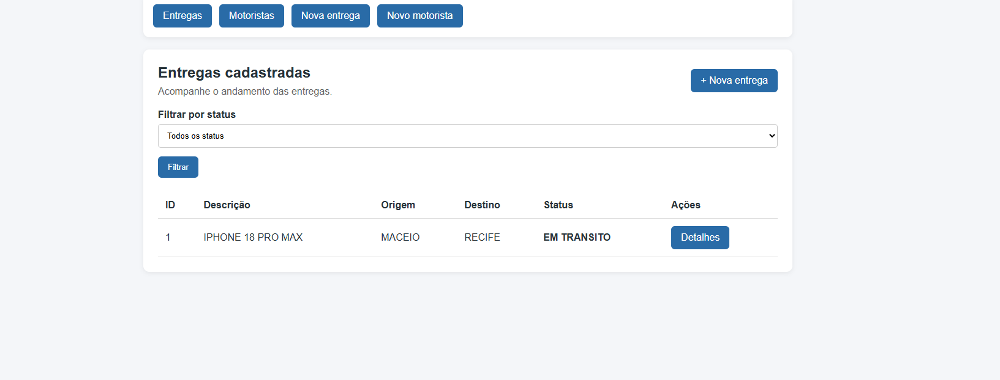

# Delivery Tracker — Interface Web SSR (EJS)

Projeto da disciplina de **Programação Web II — IFAL/Maceió**. Na **Atividade 08 (Capítulo 6)**, a aplicação anteriormente disponibilizada como API JSON passou a oferecer páginas HTML renderizadas no servidor (SSR), com Express e EJS.

A arquitetura em camadas e as regras de negócio foram preservadas: **Controller → Service → Repository Prisma → SQLite**.

## Tecnologias

- Node.js e Express
- EJS e `express-ejs-layouts` (layout e partials)
- `express-session` e `connect-flash` (mensagens de sucesso e erro)
- `method-override` (PATCH a partir de formulários HTML)
- Prisma ORM e SQLite
- `express-validator` (dependência instalada)

## Instalação e execução

Requisitos: Node.js 20 ou superior e npm.

1. Instale as dependências:

   ```bash
   npm install
   ```

2. Crie o arquivo `.env` **na raiz do projeto**, a partir do modelo:

   ```bash
   cp .env.example .env
   ```

   Conteúdo esperado:

   ```env
   DATABASE_URL="file:./dev.db"
   ```

3. Gere o Prisma Client e aplique as migrações:

   ```bash
   npx prisma generate
   npx prisma migrate deploy
   ```

4. Inicie a aplicação:

   ```bash
   npm start
   ```

5. Acesse **http://localhost:3000**. A rota `/` redireciona para `/entregas`.

Para desenvolvimento, utilize `npm run dev`. A porta padrão é `3000`, mas pode ser alterada com a variável `PORT`.

O arquivo `.env` e o banco SQLite local não devem ser enviados ao Git; as migrações Prisma são versionadas.

## Rotas da interface web

| Método | Caminho | Comportamento |
| --- | --- | --- |
| GET | `/` | Redireciona para `/entregas` |
| GET | `/entregas` | Lista entregas; filtro opcional `?status=CRIADA` |
| GET | `/entregas/nova` | Formulário de cadastro de entrega |
| POST | `/entregas` | Cria entrega e redireciona; dados inválidos reexibem o formulário |
| GET | `/entregas/:id` | Detalhes, motorista e histórico |
| PATCH | `/entregas/:id/avancar` | Avança o status |
| PATCH | `/entregas/:id/cancelar` | Cancela a entrega |
| PATCH | `/entregas/:id/atribuir` | Atribui motorista |
| GET | `/motoristas` | Lista motoristas |
| GET | `/motoristas/novo` | Formulário de cadastro de motorista |
| POST | `/motoristas` | Cadastra motorista; CPF duplicado gera erro no formulário |
| GET | `/api/health` | Responde JSON `{"status":"ok"}` |

Os formulários de alteração de estado enviam `POST` com `?_method=PATCH`; o `method-override` interpreta essas requisições como `PATCH`.

## Regras de negócio

- Entregas começam com status `CRIADA` e seguem para `EM_TRANSITO` e `ENTREGUE`.
- Uma entrega pode ser `CANCELADA` quando a regra de negócio permite.
- Entregas finalizadas não podem avançar ou ser canceladas novamente.
- Descrição, origem e destino são obrigatórios; origem e destino devem ser diferentes.
- Entregas ativas duplicadas são rejeitadas.
- Motoristas precisam de nome e CPF; CPFs duplicados são rejeitados.
- Atribuição de motorista exige entrega `CRIADA` e motorista `ATIVO`.
- O histórico registra criação, atribuição e alterações de status.

A interface utiliza **Post-Redirect-Get (PRG)** após ações bem-sucedidas e mensagens flash. Em cadastros inválidos, os formulários mostram os erros e preservam os valores digitados.

## Organização do projeto

```text
src/
├── config/
├── controllers/
├── repositories/
├── routes/
├── services/
├── utils/
└── views/
    ├── layouts/
    ├── partials/
    ├── entregas/
    ├── motoristas/
    └── erro.ejs
prisma/
├── schema.prisma
└── migrations/
docs/
└── entregas.png
```

A composição de dependências acontece em `src/routes/index.js`. Os Services mantêm as regras de negócio; os controllers lidam com requisições e respostas HTTP/HTML.

## Captura de tela

Tela de listagem de entregas, registrada durante os testes manuais da Atividade 08:



## Testes e autograder

Os principais fluxos foram testados manualmente no navegador: cadastro de entregas e motoristas, atribuição, avanço de status, cancelamento, histórico e validações de formulários.

**Importante:** o arquivo `autograder/check.mjs` presente no repositório ainda corresponde ao **Capítulo 4 (API JSON, 122 pontos)**, portanto não avalia corretamente as rotas SSR desta atividade. O professor disponibilizará o autograder SSR oficial (meta do enunciado: **115/115**). A pontuação do teste antigo não deve ser interpretada como nota da Atividade 08.

O GitHub Actions já inclui as etapas `prisma generate` e `prisma migrate deploy` antes de iniciar o servidor. Quando o novo autograder for disponibilizado, será necessário atualizar o arquivo de teste e confirmar a execução do workflow.

## Evolução do projeto

- **Atividade 05:** entregas e arquitetura em camadas.
- **Atividade 06:** motoristas, repositories e injeção de dependências.
- **Atividade 07:** persistência com Prisma e SQLite.
- **Atividade 08:** interface web SSR com EJS, formulários, PRG, flash e validações.
